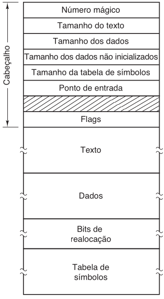
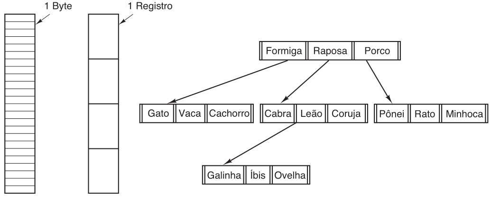
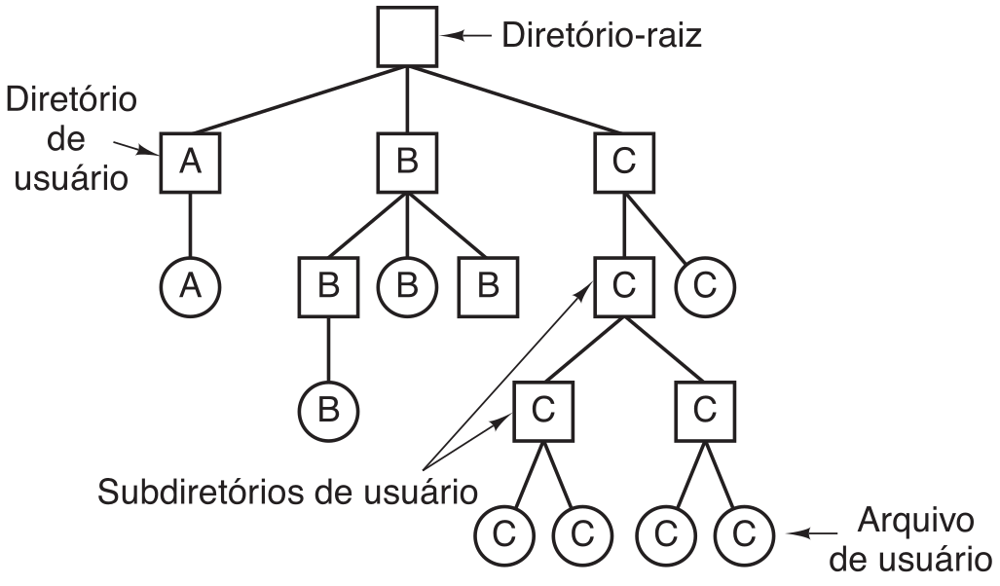
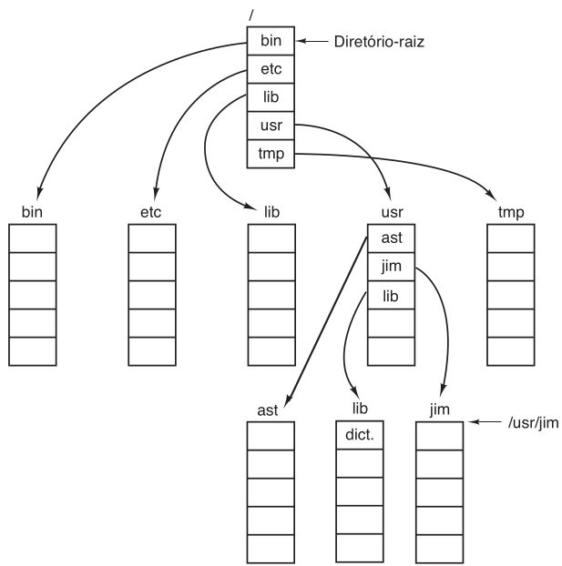

# -*- coding: utf-8 -*-
# -*- mode: org -*-
#+startup: beamer overview indent
#+LANGUAGE: pt-br
#+TAGS: noexport(n)
#+EXPORT_EXCLUDE_TAGS: noexport
#+EXPORT_SELECT_TAGS: export

#+Title: Sistemas Operacionais
#+Subtitle: Sistema de Arquivos: Interface
#+Author: Prof. Lucas Mello Schnorr (UFRGS)
#+Date: \copyleft

#+LaTeX_CLASS: beamer
#+LaTeX_CLASS_OPTIONS: [xcolor=dvipsnames,10pt]
#+OPTIONS: H:1 num:t toc:nil \n:nil @:t ::t |:t ^:t -:t f:t *:t <:t
#+LATEX_HEADER: \input{org-babel.tex}

* Estrutura da aula

- Conceito de arquivo
  - Definição e motivação do sistema de arquivos
  - Tipos de arquivo: regulares, diretórios, especiais
  - Estrutura interna de arquivos
  - Registros lógicos e blocos físicos
  - Atributos (metadados) de arquivos
- Operações sobre arquivos
  - Criar, deletar, abrir, fechar
  - Ler, escrever, reposicionar, truncar
  - Tabela de arquivos abertos
- Métodos de acesso
  - Acesso sequencial
  - Acesso direto (aleatório)
- Diretórios: a visão do usuário
  - Diretórios em árvore hierárquica
  - Caminhos absolutos e relativos

* Visão Geral: Sistema de Arquivos

O SO abstrai dispositivos físicos em uma unidade lógica: o arquivo

- Arquivos mapeados pelo SO para dispositivos físicos
- Dispositivos usualmente não voláteis: conteúdo persiste entre
  reinicializações

#+latex: \vfill

Dois papéis do sistema de arquivos:

- Oferecer visão lógica uniforme das informações armazenadas
  - Independente do tipo de mídia: disco, fita, disco ótico
  - Oculta detalhes físicos (setores, trilhas, blocos) do usuário
- Organizar os arquivos e controlar o acesso a eles
  - Diretórios, nomes e permissões

#+latex: \vfill

Arquivo: coleção nomeada de informações relacionadas gravada em
memória secundária

- Menor unidade de armazenamento lógico: dados só vão ao disco
  dentro de um arquivo

* Conceito de Arquivo

Um arquivo é uma coleção nomeada de informações em memória secundária

- Pode representar programas (fonte ou objeto) ou dados
- Dados podem ser numéricos, alfabéticos, alfanuméricos ou binários
- Pode ter forma livre (texto) ou formato rígido (banco de dados)
- Em geral: sequência de bits, bytes, linhas ou registros

#+latex: \vfill

Nome e extensão identificam o arquivo para o usuário

- Nome: sequência de caracteres (ex: example.c, prog.c)
- Extensão: parte após o ponto, indica o tipo de conteúdo
  - Ex: homepage.html.zip — .html indica HTML, .zip indica compactado
- UNIX: case-sensitive (maria, Maria e MARIA são arquivos distintos)
- MS-DOS: case-insensitive (maria, Maria e MARIA são o mesmo arquivo)

#+latex: \vfill

Ao ser nomeado, o arquivo torna-se independente do processo criador

* Tipos de Arquivo

** Left                                                              :BMCOL:
:PROPERTIES:
:BEAMER_col: 0.48
:END:

Principais tipos de arquivo:

- Regulares: contêm informações do usuário
  - Arquivos ASCII: linhas de texto editáveis
  - Arquivos binários: estrutura interna própria
- Diretórios: arquivos do sistema para manter
  a estrutura do sistema de arquivos
- Especiais de caracteres: modelam dispositivos
  de E/S seriais (terminais, impressoras)
- Especiais de blocos: modelam discos

#+latex: \vfill

UNIX e Windows: regulares e diretórios

UNIX também: especiais de caracteres e blocos

** Right                                                             :BMCOL:
:PROPERTIES:
:BEAMER_col: 0.50
:END:

Tipos comuns por extensão:

| Extensão       | Tipo                   |
|----------------+------------------------|
| .exe .com .bin | executável             |
| .obj .o        | objeto compilado       |
| .c .java .py   | código-fonte           |
| .bat .sh       | script de comandos     |
| .html .xml     | marcação               |
| .gif .jpg .pdf | impressão/visualização |
| .zip .tar .rar | arquivamento           |
| .mp3 .mp4 .avi | multimídia             |

* Exemplo de um arquivo binário

Composição interna de um arquivo executável

#+attr_latex: :width .34\linewidth

* Estrutura Interna de Arquivos

Três modelos de estrutura interna de arquivos:

- Sequência desestruturada de bytes
  - UNIX e Windows: SO vê apenas bytes, sem interpretação
  - Máxima flexibilidade; estrutura definida pelo programa
- Sequência de registros de tamanho fixo
  - Modelo histórico de mainframes
  - Leitura retorna um registro; escrita sobrepõe ou anexa
- Árvore de registros com campo chave
  - Ordenada pela chave para busca rápida
  - Usada em sistemas de processamento comercial

#+attr_latex: :width .9\linewidth
    
    

* Mapeamento entre registros lógicos e blocos físicos

- Disco opera em blocos (ex: 512 bytes por bloco)
- SO empacota e desempacota registros lógicos em blocos físicos
- Fragmentação interna: último bloco de cada arquivo parcialmente
  desperdiçado (arquivo de 1.949 bytes usa 4 blocos de 512 = 2.048)
  - /déjà vu/ de paginação

* Atributos de Arquivos

Atributos (metadados) no diretório ou em estrutura própria (i-node):

- Nome: nome simbólico, única informação legível por humanos
- Identificador: rótulo exclusivo (número) dentro do sistema
  - No UNIX: número do i-node (próxima aula)
- Tipo: necessário em sistemas com suporte a múltiplos tipos
- Locação: ponteiro para dispositivo e posição do arquivo
- Tamanho: tamanho corrente em bytes, palavras ou blocos
- Proteção: controle de acesso — quem pode ler, escrever, executar
- Horários: criação, última modificação, último acesso

#+latex: \vfill

Outros atributos presentes em alguns sistemas:

- Senha: necessidade de senha para acesso ao arquivo
- Flags: somente leitura, oculto, sistema, arquivamento, temporário
- Tamanho do registro e posição da chave (arquivos estruturados)

#+latex: \vfill

Entrada no diretório: nome do arquivo + identificador exclusivo

* Na Prática: Atributos com =ls -i= e =stat=

#+BEGIN_SRC text
$ ls -li notas.txt
10817 -rw-rw-r-- 1 schnorr schnorr 22 Oct 30 17:43 notas.txt
$ stat notas.txt
  File: notas.txt
  Size: 22         Blocks: 8          IO Block: 4096   regular file
Device: 0,37       Inode: 10817       Links: 1
Access: (0664/-rw-rw-r--)  Uid: ( 1000/ schnorr)   Gid: ( 1000/ schnorr)
Access: 2026-10-30 17:43:47.312814425 -0300
Modify: 2026-10-30 17:43:47.312814425 -0300
Change: 2026-10-30 17:43:47.312814425 -0300
 Birth: 2026-10-30 17:43:47.312814425 -0300
#+END_SRC

- Identificador: número do i-node (10817)
- Tamanho: 22 bytes, mas ocupa 8 setores de 512 bytes (um bloco de 4 KB)
- Proteção: permissões, dono e grupo
- Horários: último acesso, modificação do conteúdo e dos atributos
- Links: quantos nomes apontam para este arquivo (aula 24)

* Operações sobre Arquivos

Chamadas de sistema para as seis operações básicas:

- Criar: encontrar espaço no sistema de arquivos e criar entrada
  no diretório
- Gravar: especificar nome e informações; SO mantém ponteiro de
  gravação atualizado
- Ler: especificar nome e buffer destino na memória; SO mantém
  ponteiro de leitura (pode ser compartilhado com gravação)
- Reposicionar (seek): ponteiro da posição corrente redefinido
  para determinado valor; não envolve E/S real
- Excluir: liberar espaço do arquivo e remover entrada do diretório
- Truncar: apagar conteúdo mantendo atributos; tamanho redefinido
  para zero

#+latex: \vfill

Outras operações comuns:

- Acréscimo (append): inserir dados ao final do arquivo
- Renomear: alterar o nome simbólico do arquivo
- Obter/definir atributos: consultar e alterar metadados

* Tabela de Arquivos Abertos

A maioria das operações exige busca no diretório — operação custosa

- Solução: abrir o arquivo antes do uso com a chamada open()
- open(): lê entrada do diretório e copia para tabela em memória
- Operações subsequentes usam índice na tabela, sem nova busca

#+latex: \vfill

** Dois níveis de tabelas (sistemas com múltiplos processos)

- Tabela por processo: ponteiro da posição corrente, direitos de
  acesso, informações de contabilidade (exclusivas por processo)
- Tabela para todo o sistema: locação em disco, datas, tamanho
  (compartilhada entre processos)

** Informações por arquivo aberto

- Ponteiro do arquivo: posição corrente de leitura/gravação
- Contagem de aberturas: número de processos que abriram o arquivo
  (entrada removida ao atingir zero no close())
- Locação em disco: endereço físico em cache de memória
- Direitos de acesso: modalidade de abertura por processo

* Métodos de Acesso: Sequencial

Acesso sequencial: informações processadas em ordem, um registro
após o outro

- Mais comum: editores, compiladores e filtros usam essa modalidade
- Modelo baseado em arquivo em fita; funciona em qualquer dispositivo

#+latex: \vfill

Operações do acesso sequencial:

- =read_next()=: lê próxima porção e avança o ponteiro do arquivo
- =write_next()=: acrescenta ao fim e avança para o novo fim
- =reset=: reposiciona ponteiro no início do arquivo
- =skip(n)=: salta para a frente ou para trás n registros

#+latex: \vfill

Ponteiro de posição corrente: mantido pelo SO por processo

- Atualizado após cada leitura ou gravação
- Unifica os ponteiros de leitura e gravação em um único ponteiro

* Métodos de Acesso: Direto

Acesso direto (acesso relativo): leitura e gravação em qualquer
ordem, sem restrições de sequência

- Modelo baseado em arquivo em disco (acesso randômico por bloco)
- Arquivo visto como sequência numerada de blocos
  - Ex: ler bloco 14, depois bloco 53, depois gravar bloco 7

#+latex: \vfill

Número de bloco relativo: índice a partir do início do arquivo

- SO traduz número relativo para endereço físico real
- Protege o usuário de acessar partes fora do seu arquivo

#+latex: \vfill

** Comparação dos métodos de acesso

| Critério        | Sequencial             | Direto                 |
|-----------------+------------------------+------------------------|
| Ordem de acesso | estrita (início→fim)   | qualquer ordem         |
| Operação chave  | =read_next()=          | =read(n)= / =write(n)= |
| Aplicações      | editores, compiladores | bancos de dados        |
| Origem          | modelo de fita         | modelo de disco        |

* Diretórios: Conceito

Diretório: estrutura do sistema de arquivos que mapeia nomes de
arquivos para suas localizações no dispositivo

- Diretórios são em si arquivos armazenados no dispositivo
- Entrada no diretório: nome do arquivo + identificador exclusivo
- Identificador localiza os demais atributos do arquivo

#+latex: \vfill

Funções do sistema de diretórios:

- Eficiência: localizar arquivos rapidamente
- Nomeação: usuários distintos podem dar nomes iguais a arquivos
  diferentes; mesmo arquivo pode ter múltiplos nomes
- Agrupamento: arquivos relacionados são mantidos juntos

#+latex: \vfill

Operações sobre diretórios (UNIX):

- create / delete / opendir / closedir / readdir
- rename, link, unlink

* Diretórios em Árvore Hierárquica

Hierarquia de diretórios: árvore com diretório-raiz no topo

- Usuário pode criar qualquer número de subdiretórios
- Arquivos relacionados são agrupados naturalmente
- Cada usuário tem diretório-raiz privado em servidores compartilhados

#+latex: \vfill

#+attr_latex: :width .5\linewidth

#+latex: \vfill

Cada processo tem seu próprio diretório de trabalho (atual)

- Muda com a chamada chdir()
- Mudança é local ao processo: não afeta outros processos
- Subdiretórios especiais: . (diretório atual) e .. (diretório pai)

* Uma árvore de diretórios UNIX

#+attr_latex: :width .65\linewidth

* Caminhos Absolutos e Relativos

Dois tipos de caminhos para identificar um arquivo na árvore:

#+latex: \vfill

Caminho absoluto: caminho completo do diretório-raiz até o arquivo

- Começa sempre com / (UNIX) ou \ (Windows)
- Único e não ambíguo — independe do diretório de trabalho
- Ex: /usr/ast/caixapostal

#+latex: \vfill

Caminho relativo: caminho a partir do diretório de trabalho atual

- Não começa com o separador de raiz
- Mais curto e conveniente; depende do diretório atual
- Ex: caixapostal (se diretório atual for /usr/ast)

#+latex: \vfill

| Caminho      | UNIX                     | Windows                  |
|--------------+--------------------------+--------------------------|
| Separador    | /                        | \                        |
| Raiz         | /                        | C:\                      |
| Diretório pai| ..                       | ..                       |
| Dir. atual   | .                        | .                        |

* Referências

- Silberschatz
  - Cap. 11, Secs. 11.1, 11.2, 11.3.1, 11.3.2
- Tanenbaum
  - Cap. 4, Secs. 4.1.1, 4.1.2, 4.1.3, 4.1.4, 4.1.5, 4.1.6,
    4.2.1, 4.2.2, 4.2.3, 4.2.4
