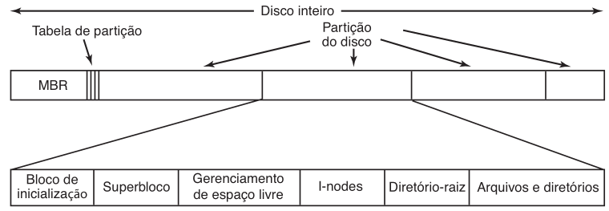
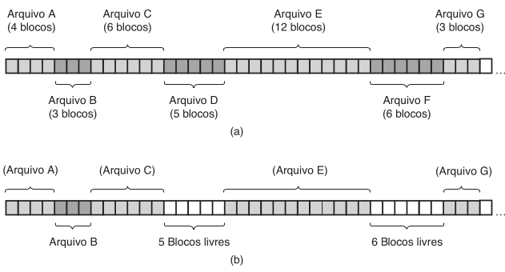
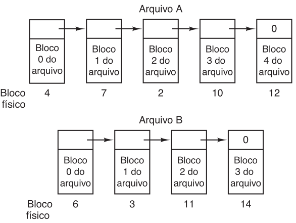
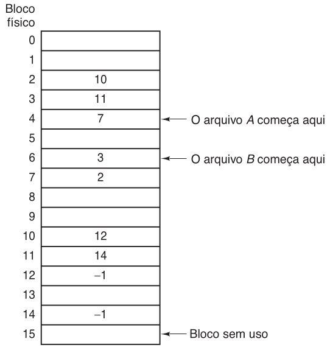
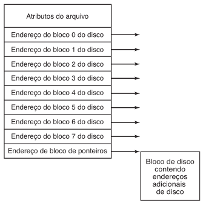

# -*- coding: utf-8 -*-
# -*- mode: org -*-
#+startup: beamer overview indent
#+LANGUAGE: pt-br
#+TAGS: noexport(n)
#+EXPORT_EXCLUDE_TAGS: noexport
#+EXPORT_SELECT_TAGS: export

#+Title: Sistemas Operacionais
#+Subtitle: Sistema de Arquivos: Implementação
#+Author: Prof. Lucas Mello Schnorr (UFRGS)
#+Date: \copyleft

#+LaTeX_CLASS: beamer
#+LaTeX_CLASS_OPTIONS: [xcolor=dvipsnames,10pt]
#+OPTIONS: H:1 num:t toc:nil \n:nil @:t ::t |:t ^:t -:t f:t *:t <:t
#+LATEX_HEADER: \input{org-babel.tex}

* Estrutura da aula

- Do disco ao sistema de arquivos
  - Formatação física (baixo nível)
  - Particionamento e formatação lógica
  - Layout do sistema de arquivos em disco
- Métodos de alocação de espaço em disco
  - Alocação contígua
  - Alocação encadeada e FAT
  - Alocação indexada: i-nodes
  - Desempenho dos métodos
- Gerenciamento do espaço livre
  - Mapa de bits
  - Lista encadeada, agrupamento e contagem

* -- Do Disco ao Sistema de Arquivos: Formatação Física

Disco novo é apenas material magnético bruto sem estrutura

- Formatação de baixo nível (formatação física) divide o disco em setores
  - Permite que o controlador leia e grave setores individualmente

#+latex: \vfill

- Estrutura de cada setor:
  - Cabeçalho: número de cilindro, número de setor, sincronização
  - Área de dados: geralmente 512 bytes
  - Trailer: código de correção de erros (ECC)
- ECC permite detectar e corrigir erros de leitura automaticamente

#+latex: \vfill

- Setores sobressalentes reservados para substituir setores defeituosos
  - Fabricante mapeia blocos lógicos para setores físicos sem defeito
- Deslocamento de cilindro: setor 0 de trilhas consecutivas é deslocado
  - Melhora leitura contínua entre trilhas ao compensar o tempo de busca

* Particionamento e Formatação Lógica

Após a formatação física, o disco precisa de estrutura lógica

- Particionamento: dividir o disco em grupos de cilindros
  - Cada partição tratada pelo SO como um disco independente
  - Setor 0 contém o MBR (Master Boot Record) com tabela de partições
  - MBR suporta discos até 2 TB; GPT (GUID Partition Table) até 9,4 ZB

#+latex: \vfill

- Formatação lógica (criação do sistema de arquivos):
  - SO grava estruturas iniciais: mapa de espaço livre, diretório raiz
  - Define o tipo do sistema de arquivos na tabela de partições

#+latex: \vfill

- Agrupamento em clusters: blocos agrupados para reduzir E/S aleatória
  - E/S de sistema de arquivos em clusters; E/S de disco em blocos
- Disco bruto: partição sem sistema de arquivos
  - Bancos de dados podem usar disco bruto para controle direto

* MBR \times GPT

#+attr_latex: :font \small
|                     | MBR                         | GPT (GUID Partition Table)          |
|---------------------+-----------------------------+-------------------------------------|
| Endereço de setor   | 32 bits                     | 64 bits                             |
| Tamanho máximo      | 2 TB (2^{32} \times 512 B)  | \approx 9,4 ZB (2^{64} \times 512 B) |
| Número de partições | 4 primárias                 | 128 (padrão)                        |
| Identificação       | tipo em 1 byte              | GUID de 128 bits                    |
| Robustez            | cópia única (setor 0)       | cópia no fim do disco + CRC         |

GPT faz parte do UEFI e mantém um MBR protetor no setor 0

** Na prática: =lsblk= (tabela GPT, partição EFI e =/boot=)
#+latex: {\footnotesize
#+BEGIN_SRC text
$ lsblk -i -o NAME,SIZE,PTTYPE,PARTTYPENAME,FSTYPE,MOUNTPOINT /dev/nvme1n1
NAME          SIZE PTTYPE PARTTYPENAME     FSTYPE      MOUNTPOINT
nvme1n1       3.7T gpt
|-nvme1n1p1   512M gpt    EFI System       vfat        /boot/efi
|-nvme1n1p2   488M gpt    Linux filesystem ext2        /boot
`-nvme1n1p3   3.7T gpt    Linux filesystem crypto_LUKS
$ lsblk -no PARTUUID /dev/nvme1n1p1
5571d6bc-fde7-4044-82ac-bbeef9252952
#+END_SRC
#+latex: }

* Layout do Sistema de Arquivos em Disco
** Estrutura do disco inteiro

MBR (setor 0): tabela de partições + código de inicialização

#+attr_latex: :width .65\linewidth

** Estrutura típica de uma partição

#+latex: \vfill

| Região                   | Conteúdo                              |
|--------------------------+---------------------------------------|
| Bloco de inicialização   | Código para carregar o SO             |
| Superbloco               | Tipo, número de blocos, parâmetros    |
| Gerenciamento de livres  | Mapa de bits ou lista encadeada       |
| Região de i-nodes        | Um i-node por arquivo (atributos)     |
| Diretório raiz           | Topo da árvore do sistema de arquivos |
| Área de dados            | Arquivos e diretórios                 |

* Superbloco e I-nodes
#+latex: \vfill

Duas estruturas centrais da partição (UNIX)

- Superbloco: lido na memória ao montar o sistema de arquivos
  - Número mágico identifica o tipo do FS
- I-node: contém atributos + endereços dos blocos do arquivo
  - Carregado na memória apenas quando o arquivo está aberto
- Número do i-node: o identificador do arquivo (=ls -i=)

#+latex: \vfill

Como o i-node guarda os endereços dos blocos? → métodos de alocação

* -- Métodos de Alocação de Espaço em Disco

Principal problema: como alocar blocos em disco para arquivos

- Objetivo: eficiência de armazenamento e rapidez de acesso

#+latex: \vfill

Três métodos principais:

- Contíguo: arquivo ocupa blocos consecutivos no disco
  - Acesso direto e sequencial eficientes; simples de implementar
- Encadeado: arquivo é lista encadeada de blocos dispersos
  - Sem fragmentação externa; crescimento dinâmico
- Indexado: ponteiros reunidos em bloco de índices por arquivo
  - Acesso direto sem fragmentação externa

#+latex: \vfill

- Cada método tem vantagens e desvantagens distintas
- Sistemas de arquivos adotam geralmente um único método

* Alocação Contígua: Estrutura e Acesso

Cada arquivo ocupa conjunto de blocos consecutivos no disco

#+attr_latex: :width .5\linewidth

# - Arquivo definido por bloco inicial b e tamanho n
#   - Ocupa blocos b, b+1, b+2, …, b+n-1
# - Entrada de diretório armazena apenas b e n

#+latex: \vfill

** Acesso eficiente

- Sequencial: lê próximo bloco sem busca adicional no disco
- Direto ao bloco i: acessa bloco b+i imediatamente
  - Sem percorrer cadeia; fórmula simples
- Número mínimo de movimentos do cabeçote do disco

#+latex: \vfill

** Simples de implementar: apenas dois números por arquivo
- Leitura de arquivo inteiro em uma única operação contígua

* Alocação Contígua: Problemas e Extensões
** Dois problemas principais

- Fragmentação externa: alocações e liberações fragmentam o espaço
  - Espaço livre dividido em lacunas não contíguas
  - Compactação resolve mas pode levar horas em discos grandes
- Determinação do tamanho: tamanho final deve ser conhecido na criação
  - Subestimar impede extensão; superestimar causa fragmentação interna

#+latex: \vfill\pause

** Solução parcial: extensões

- Aloca porção contígua inicial; adiciona extensão se necessário
- Registro: endereço + contagem de blocos + link p/ próxima extensão
- Ainda sujeito a fragmentação interna e externa

#+latex: \vfill\pause

** Alocação contígua ainda usada em mídias óticas (CD-ROM, DVD)
- Tamanhos conhecidos antecipadamente; sem modificações

* Alocação Encadeada: Estrutura

Cada arquivo é lista encadeada de blocos de disco

#+attr_latex: :width .5\linewidth

- Blocos dispersos em qualquer posição no disco
- Cada bloco contém ponteiro para o próximo bloco
- Diretório armazena ponteiro para primeiro (e último) bloco

* Alocação Encadeada: Vantagens e Desvantagens
** Vantagens
- Sem fragmentação externa: qualquer bloco livre serve
- Tamanho do arquivo não precisa ser declarado na criação
- Arquivo cresce dinamicamente enquanto houver blocos livres
- Nunca é necessário compactar o disco

#+latex: \vfill

*Criação de arquivo*

- Nova entrada no diretório com ponteiro nulo (arquivo vazio)
- Gravação: sistema aloca bloco livre e encadeia ao fim da lista

#+latex: \vfill\pause

** Desvantagens

- Acesso direto ineficiente
  - Encontrar bloco i implica percorrer lista encadeada
    - Cada um requer leitura em disco
- Sobrecarga de ponteiros: 4 bytes por bloco de 512 bytes \approx0.78%
- Confiabilidade: ponteiro corrompido desencadeia em arquivo errado
  - Soluções: lista duplamente encadeada; nº de bloco em cada bloco

* Alocação Encadeada: FAT (File Allocation Table) 1/2

** Trata-se de uma variação da lista encadeada

Uma tabela que fica em RAM
- Reservada no início do volume
- Uma entrada por bloco
- Entrada contém número do próximo bloco (ou marcador EOF/livre)

** Left                                                              :BMCOL:
:PROPERTIES:
:BEAMER_col: 0.50
:END:

#+attr_latex: :width .8\linewidth

** Right                                                             :BMCOL:
:PROPERTIES:
:BEAMER_col: 0.5
:END:

#+attr_latex: :width .7\linewidth

* Alocação Encadeada: FAT (File Allocation Table) 2/2
** Tabela em RAM, os dados no disco
- Bloco inteiro fica disponível para os dados
  - Não tem mais lista encadeada nos blocos
- Encadeamento é realizado na FAT

#+latex: \vfill

** Desvantagem da FAT: tabela inteira deve ficar em memória
- Disco de 1 TB com blocos de 1 KB → tabela de \approx 3 GB

* Alocação Indexada (I-nodes): Características

Todos os ponteiros do arquivo reunidos em um _bloco de índices_

- Cada arquivo tem seu próprio bloco de índices
- i-ésima entrada aponta para o i-ésimo bloco do arquivo
- Diretório armazena endereço do bloco de índices
- Ao criar arquivo: todos os ponteiros inicializados com nulo
- UNIX: o bloco de índices faz parte do i-node do arquivo

#+latex: \vfill

** Um exemplo de i-node (index-node, ou nó-índice)

#+attr_latex: :width .4\linewidth

* Alocação Indexada (I-nodes): Vantagens e Desvantagens
** Vantagens
- Acesso direto eficiente: usa ponteiro i sem percorrer cadeia
- Sem fragmentação externa: qualquer bloco livre serve
- Similar ao esquema de paginação de memória virtual
** Desvantagem: desperdício para arquivos pequenos
- Bloco de índices inteiro alocado mesmo com 1 ou 2 blocos usados
- i-node carregado em memória apenas quando arquivo está aberto
  — memória proporcional a arquivos abertos, não ao tamanho do disco

#+attr_latex: :width .28\linewidth

  

* Alocação Indexada: Mecanismos para Arquivos Grandes

Bloco de índices pequeno demais não suporta arquivos grandes

#+latex: \vfill

** Três mecanismos

- Esquema encadeado: último ponteiro do bloco de índices aponta
  para outro bloco de índices (nulo se arquivo pequeno) @@latex: \pause@@
- Índices em dois níveis
  - Blocos de nível 1 apontam para blocos de nível 2
  - Blocos de nível 2 apontam para blocos de dados
    - 2 níveis, blocos de 4 KB: suporta até 4 GB por arquivo  @@latex: \pause@@
- Esquema combinado (UNIX), temos com ponteiros ocupando 4 bytes
  - 12 ponteiros diretos → blocos de dados
    - Até 12 \times 4KB = 48KB
  - 1 ponteiro indireto simples → bloco com endereços de dados
    - Referencia até 1024 blocos \times 4KB = 4MB
  - 1 ponteiro indireto duplo → dois níveis de blocos de índices
    - Referencia até 1024^2 blocos \times 4KB = 4GB
  - 1 ponteiro indireto triplo → três níveis de blocos de índices
    - Referencia até 1024^3 blocos \times 4KB = 4TB
  - O tamanho máximo total do arquivo seria aproximadamente:
    - 48KB + 4MB + 4GB + 4TB (todos os ponteiros coexistem)

* Alocação Indexada: Ponteiros de 8 Bytes

** Reflexão

Se os ponteiros ocuparem 8 bytes, cabem menos ponteiros nos blocos
- Tamanho máximo total aproximado do arquivo: 48KB+2MB+1GB+512GB
Sistemas modernos (ZFS, Btrfs) usam outras abordagens
- extents, B-trees, árvores balanceadas nos I-nodes

* Desempenho dos Métodos de Alocação

** Comparação pelo número de acessos ao disco:

- Contígua: 1 acesso para qualquer bloco (direto ou sequencial)
  - Melhor desempenho para ambos os tipos de acesso
- Encadeada: adequada para acesso sequencial
  - Acesso direto ao bloco i requer i leituras em disco
- Indexada: acesso direto com bloco de índices em memória
  - Índice de 2 níveis: até 2 leituras extras antes dos dados

#+latex: \vfill

** Estratégias combinadas

- Alguns sistemas: contígua para acesso direto,
  encadeada para acesso sequencial
  - Tipo declarado na criação do arquivo
- Outros sistemas: contígua para arquivos pequenos (<= 3--4 blocos);
  indexada para arquivos maiores
  - Maioria dos arquivos é pequena → desempenho médio bom

* -- Gerenciamento do Espaço Livre: Mapa de Bits

Quais blocos do disco estão livres?

#+latex: \vfill

Mapa de bits (vetor de bits): um bit por bloco

- Bit 1: bloco livre; bit 0: bloco alocado (ou vice-versa)
- Ex: blocos 2, 3, 4, 5, 8 a 13, 17, 18 e 25 a 27 livres
  - =001111001111110001100000011100000...=
- Achar o primeiro livre: pular palavras com valor 0
  - Bloco = bits por palavra \times palavras zeradas + deslocamento
  - Instruções de manipulação de bits ajudam na busca

#+latex: \vfill

Custo: o mapa precisa caber na memória para ser eficiente

- Disco de 1 TB com blocos de 4 KB → mapa de 32 MB
- Facilita alocar blocos contíguos (vizinhos no mapa)

* Espaço Livre: Lista Encadeada, Agrupamento e Contagem

Lista encadeada de blocos livres

- Cada bloco livre aponta para o próximo; SO guarda o primeiro
- Alocar um bloco é rápido; percorrer a lista exige ler cada bloco
- FAT: espaço livre já registrado na própria tabela

#+latex: \vfill

Agrupamento: primeiro bloco livre guarda n endereços de livres

- n-1 blocos livres e o último aponta para outro grupo de n
- Tanenbaum: bloco de 1 KB com endereços de 32 bits → 255 livres

#+latex: \vfill

Contagem: par (primeiro bloco livre, n blocos contíguos)

- Lista curta quando o espaço livre é contíguo (como extensões)

#+latex: \vfill

Mapa de bits \times lista (disco de 1 TB, blocos de 1 KB)

- Mapa: \approx 130 mil blocos; lista: \approx 4 milhões de blocos
- Lista só ocupa menos se o disco estiver quase cheio

* Referências

- Silberschatz
  - Cap. 10, Sec. 10.5.1 (Formatação de Disco)
  - Cap. 12, Sec. 12.4 (Métodos de Alocação)
  - Cap. 12, Sec. 12.5 (Gerenciamento do Espaço Livre)
- Tanenbaum
  - Cap. 4, Sec. 4.3.1 (Layout do sistema de arquivos)
  - Cap. 4, Sec. 4.3.2 (Implementando arquivos)
  - Cap. 4, Sec. 4.4.1 (Gerenciamento de espaço em disco)
  - Cap. 5, Sec. 5.4.2 (Formatação de disco)
