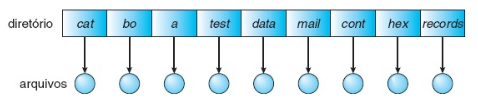
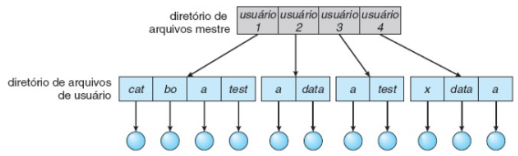
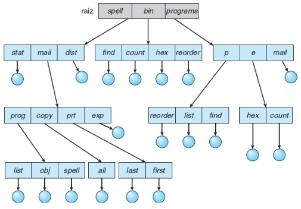
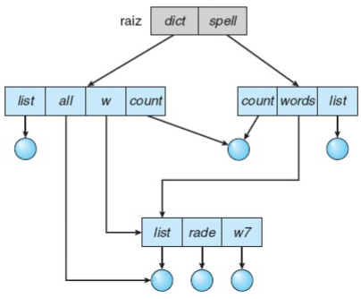
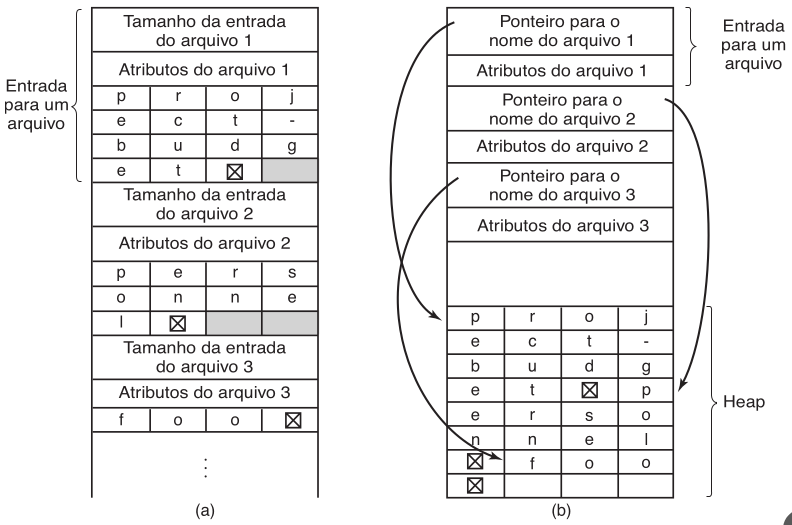
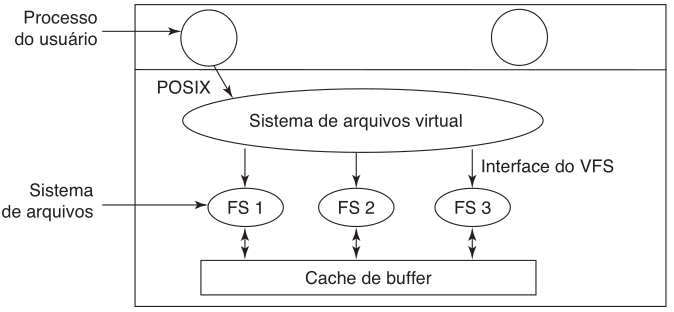

# -*- coding: utf-8 -*-
# -*- mode: org -*-
#+startup: beamer overview indent
#+LANGUAGE: pt-br
#+TAGS: noexport(n)
#+EXPORT_EXCLUDE_TAGS: noexport
#+EXPORT_SELECT_TAGS: export

#+Title: Sistemas Operacionais
#+Subtitle: Diretórios, Links e Montagem
#+Author: Prof. Lucas Mello Schnorr (UFRGS)
#+Date: \copyleft

#+LaTeX_CLASS: beamer
#+LaTeX_CLASS_OPTIONS: [xcolor=dvipsnames,10pt]
#+OPTIONS: H:1 num:t toc:nil \n:nil @:t ::t |:t ^:t -:t f:t *:t <:t
#+LATEX_HEADER: \input{org-babel.tex}

* Estrutura da aula

- Diretórios
  - Propósito e operações
  - Estruturas: nível único, dois níveis, árvore, grafos
  - Implementação: lista linear e tabela de dispersão
  - Conteúdo das entradas de diretório
- Links e compartilhamento
  - Ligações rígidas e simbólicas
- Vários sistemas de arquivos
  - Montagem
  - Sistema de arquivos virtual (VFS)

* Propósito e Operações de Diretório

** Diretório
- Tabela de símbolos que mapeia nomes de arquivos para onde está o arquivo
- Organização deve permitir: inserir, excluir, buscar, listar

** Principal função de diretórios
- Mapear nome em ASCII para dado no disco
  - Endereço de disco, número do primeiro bloco, ou i-node

** Operações sobre diretório

- Busca de arquivo: encontrar a entrada pelo nome (ou padrão)
- Criação de arquivo: adicionar nova entrada ao diretório
- Exclusão de arquivo: remover a entrada e liberar espaço
- Listagem de diretório: exibir arquivos e seus atributos
- Renomeação de arquivo: alterar nome (e posição na estrutura)
- Varredura no sistema de arquivos: percorrer toda a árvore

* Diretório de Nível Único

Estrutura mais simples: todos os arquivos em um único diretório

#+attr_latex: :width .65\linewidth

#+latex: \vfill

** Vantagens
- Fácil de implementar e entender
- Sem hierarquia a gerenciar

** Limitações
- Todos os nomes de arquivo devem ser globalmente exclusivos
- Colisão inevitável com múltiplos usuários
  - Exemplo: 23 alunos chamam o arquivo de prog2.c
- Difícil de gerenciar com centenas ou milhares de arquivos

#+latex: \vfill

- Suporte a nomes com até 255 caracteres ajuda, mas não resolve
- Impraticável em sistemas multiusuário

* Diretório de Dois Níveis

Solução: criar diretório separado para cada usuário

#+attr_latex: :width .65\linewidth

#+latex: \vfill

** Componentes

- MFD (Master File Directory): indexado por nome de usuário
  - Cada entrada aponta para o UFD do usuário
- UFD (User File Directory): lista os arquivos de um usuário
  - Nomes exclusivos apenas dentro do UFD

#+latex: \vfill

** Características

- Diferentes usuários podem ter arquivos com o mesmo nome
- Acesso a arquivo próprio: test.txt
- Acesso a arquivo de outro usuário: /userb/test.txt
- Isolamento entre usuários (vantagem e desvantagem)

* Diretório em Árvore

Generalização natural: árvore de altura arbitrária

- Raiz única; cada arquivo tem nome de caminho exclusivo
- Usuários criam subdiretórios para organizar seus arquivos
- Cada processo possui um diretório corrente

#+attr_latex: :width .35\linewidth

#+latex: \vfill

** Tipos de caminho
- Absoluto (/home/joao/prog/main.c) ou relativo (prog/main.c)

#+latex: \vfill

** Exclusão de diretório
- Diretório vazio: remove entrada no diretório pai
- Diretório não vazio — duas políticas:
  - Recusar exclusão até vazio OU Remover recursivamente

* Diretório em Grafo Acíclico 1/2

Motivação: dois programadores compartilham subdiretório de projeto

- Árvore proíbe compartilhamento; grafo acíclico permite
- Um arquivo ou diretório existe em dois ou mais locais
- Não é cópia: alteração visível a todos os usuários

#+latex: \vfill\pause

#+attr_latex: :width .65\linewidth

* Diretório em Grafo Acíclico 2/2
** Implementações de compartilhamento

- +Duplicação de entrada: cópias idênticas nos dois diretórios+
  - Problema de consistência ao modificar
- Link simbólico: entrada com nome de caminho do alvo
  - SO resolve o caminho ao abrir o arquivo

#+latex: \pause

** Problema com exclusão

- Remover arquivo deixa ponteiros pendentes
- Solução: contagem de referências no i-node
  - Arquivo excluído quando contagem chega a zero

#+latex: \pause

** Left                                                              :BMCOL:
:PROPERTIES:
:BEAMER_col: 0.48
:END:

*** Contagem de referências

- Criar link: incrementa contador
- Remover link: decrementa contador
- Contador = 0: arquivo excluído

#+latex: \pause

** Right                                                             :BMCOL:
:PROPERTIES:
:BEAMER_col: 0.48
:END:

*** Grafo acíclico no UNIX

- Hard links usam contagem no i-node
- Proibir links para diretórios
  - Garante estrutura acíclica

* Grafo Geral de Diretórios

Links adicionados a uma árvore podem criar ciclos

- Estrutura resultante: grafo geral (não mais acíclico)
- Exemplo: link de subdiretório apontando para ancestral

#+latex: \vfill

** Problemas com ciclos
- Algoritmos de percurso podem entrar em loop infinito
  - Solução: limitar número de diretórios visitados
- Contagem de referências pode ser incorreta com ciclos
  - Autorreferência mantém contador positivo mesmo sem usuários

#+latex: \vfill

** Coleta de lixo (garbage collection)
- Varredura completa do sistema de arquivos marcando acessíveis
- Segunda passagem libera tudo que não está marcado
- Muito custosa em disco; raramente executada

#+latex: \vfill

- Preferível: evitar ciclos ao criar novos links
  - Ignorar links durante travessias de diretório

* -- Implementação de Diretório: Lista Linear

** Método mais simples de implementação

Lista de entradas (nome + ponteiro para dados)

** Operações
- Criar: buscar nome duplicado; adicionar entrada ao final
- Excluir: buscar entrada; marcar livre ou compactar lista
- Buscar: percorrer linearmente do início ao fim

#+latex: \vfill

** Desempenho
- Busca linear: O(n) \to lenta para diretórios grandes
- Muitos SOs usam cache de diretório (entradas recentes)
- Lista ordenada: permite busca binária O(log n)
  - Complica inserção e exclusão (manter ordem)
- Árvore balanceada: insere e busca em O(log n)

* Implementação de Diretório: Tabela de Dispersão
** Método mais sofisticado

Lista linear + tabela hash para acelerar buscas
- Hash do nome de arquivo → índice na tabela
- Tabela aponta para entrada na lista linear

#+latex: \vfill

** Vantagens
- Busca muito mais rápida do que a linear
- Inserção e exclusão também mais eficientes
** Desvantagens
- Colisões: dois nomes mapeados para o mesmo índice
  - Tratamento: lista encadeada de entradas colidentes
- Redimensionar exige recalcular todos os hashes

#+latex: \vfill\pause

** Vale a pena?

- Recomendada apenas se diretório tem muitos arquivos
- Cache de buscas: guarda resultados recentes em memória
  - Eficaz quando poucos arquivos são acessados

* Conteúdo das Entradas de Diretório 1/2

Questão de projeto: onde armazenar os atributos do arquivo?

#+latex: \vfill\pause

** Opção A — atributos na entrada de diretório
- Entrada: nome fixo + atributos + endereços de disco
- Usado em FAT (MS-DOS/Windows)
- Simples; atributos sempre acessíveis com o nome
** Opção B — atributos no i-node (UNIX/Linux)
- Entrada curta: nome + número de i-node
- Atributos e blocos ficam no i-node
- Vantagem: suporta ligações rígidas com facilidade
#+latex: \vfill\pause

* Conteúdo das Entradas de Diretório 2/2
** Nomes de tamanho variável
- Abordagem sequencial
  - Entrada com tamanho variável
  - Nome termina com byte nulo
  - Alinhado em múltiplo de palavra
- Abordagem com heap
  - Entrada fixa com ponteiro para heap
  - Nomes armazenados em área separada
  - Remoção não deixa lacuna no heap

#+attr_latex: :width .65\linewidth

* -- Ligações Rígidas (Hard Links)

Ligação rígida: nova entrada de diretório apontando
para o mesmo i-node de um arquivo existente

- Dois (ou mais) caminhos referenciam o mesmo arquivo
- Não há cópia: um único arquivo físico
- Contador de referências armazenado no i-node

#+latex: \vfill

** Semântica de exclusão
- Remover um link: decrementa contador no i-node
- Arquivo excluído apenas quando contador chega a zero
- Proprietário original pode remover seu link: arquivo persiste
  enquanto outros links existirem

#+latex: \vfill

** Restrições típicas
- Ligações rígidas para diretórios geralmente proibidas
  - Evita ciclos no grafo de diretórios
- Ligações rígidas restritas ao mesmo sistema de arquivos
  - I-nodes são locais a uma partição

#+latex: \vfill

Exemplo: =ln arquivo.txt link_rigido.txt=

* Ligações Simbólicas (Soft Links)

Ligação simbólica: arquivo especial do tipo LINK
contendo o nome de caminho do arquivo alvo

- SO detecta tipo LINK ao abrir; resolve o caminho
- Nível de indireção extra a cada acesso

#+latex: \vfill

** Vantagens
- Funciona entre diferentes sistemas de arquivos
- Pode referenciar arquivos em outras máquinas (NFS)
- Remover link não afeta o arquivo original

** Problemas
- Link pendente (dangling link): arquivo original excluído
  - Acesso subsequente falha com "arquivo não encontrado"
  - UNIX deixa links pendentes; cabe ao usuário perceber
- Sobrecarga extra: ler arquivo de link + resolver caminho
  - Cada componente do caminho exige acesso ao disco
- I-node extra necessário para cada ligação simbólica

#+latex: \vfill

Exemplo: =ln -s /home/joao/dados.txt link_simbolico.txt=

* Na Prática: Links com =ln= e =ls -li=

#+BEGIN_SRC text
$ ln notas.txt rigido.txt
$ ln -s notas.txt simbolico.txt
$ ls -li
10817 -rw-rw-r-- 2 schnorr schnorr 22 Oct 30 17:43 notas.txt
10817 -rw-rw-r-- 2 schnorr schnorr 22 Oct 30 17:43 rigido.txt
10818 lrwxrwxrwx 1 schnorr schnorr  9 Oct 30 17:43 simbolico.txt -> notas.txt
$ rm notas.txt
$ ls -li
10817 -rw-rw-r-- 1 schnorr schnorr 22 Oct 30 17:43 rigido.txt
10818 lrwxrwxrwx 1 schnorr schnorr  9 Oct 30 17:43 simbolico.txt -> notas.txt
$ cat simbolico.txt
cat: simbolico.txt: No such file or directory
#+END_SRC

- Link rígido: mesmo i-node (10817); contador de links vai a 2
- Link simbólico: i-node próprio (10818) contendo o caminho
- Após =rm=: dado preservado via =rigido.txt=; simbólico fica pendente

* -- Montagem de Sistemas de Arquivos

Sistema de arquivos deve ser montado antes de ser usado

- Estrutura de diretórios pode abranger múltiplos volumes

#+latex: \vfill

** Procedimento de montagem
- SO recebe: nome do dispositivo + ponto de montagem
  - Ponto de montagem: diretório (geralmente vazio)
- Verifica estrutura do dispositivo (formato válido)
- Registra montagem na estrutura interna de diretórios
- SO percorre diretórios alternando entre sistemas de arquivos

#+latex: \vfill

** Exemplos
- UNIX: montar /dev/sdb1 em /home
  - Acesso via /home/jane/arquivo.txt
- Mac OS X: monta automaticamente em /Volumes/nome
- Windows: letras de drive (C:\) ou ponto de montagem

#+latex: \vfill

- UNIX: montagem explícita; arquivo /etc/fstab para boot
- Desmontagem restaura diretório original no ponto de montagem

* Na Prática: =df -T= e =mount=

#+BEGIN_SRC text
$ df -T / /home
Filesystem                   Type  1K-blocks       Used Available Use% Mounted on
/dev/mapper/larioja--vg-root ext4  807285964  315187252 458979408  41% /
/dev/mapper/larioja--vg-home ext4 7065384208 6386423060 352088956  95% /home
$ mount | grep -E " / | /home "
/dev/mapper/larioja--vg-root on / type ext4 (rw,relatime,errors=remount-ro)
/dev/mapper/larioja--vg-home on /home type ext4 (rw,relatime)
#+END_SRC

- Dois sistemas de arquivos ext4, uma única árvore de diretórios
- =/home= é ponto de montagem: o conteúdo vem de outro volume
- Opções de montagem: =rw= (leitura e escrita), =relatime= (atualização
  econômica do horário de acesso)

* Sistema de Arquivos Virtual (VFS)

Múltiplos sistemas de arquivos coexistem no mesmo computador

- ext4, NTFS, FAT32, NFS, ISO 9660 — todos ao mesmo tempo
- Windows: cada SF identificado por letra de unidade (C:, D:...)
- UNIX: hierarquia única integrada pelo VFS

#+latex: \vfill\pause

** VFS — /Virtual File System/ (Sun Microsystems, 1986)

- Abstrai a parte comum a todos os sistemas de arquivos
- Interface superior (POSIX): open, read, write, lseek, ...
- Interface inferior (VFS): funções implementadas por cada SF

#+attr_latex: :width .5\linewidth

#+latex: \vfill

** Objetos: Superbloco, V-node (/i-node/), Tabelas

* Referências

- Silberschatz
  - Cap. 11, Secs. 11.3.2–11.3.7 (Estrutura de Diretórios)
  - Cap. 11, Sec. 11.4 (Montagem do Sistema de Arquivos)
  - Cap. 12, Sec. 12.2 (Partições, Montagem e VFS)
  - Cap. 12, Sec. 12.3 (Implementação de Diretórios)
- Tanenbaum
  - Cap. 4, Sec. 4.3.3 (Implementando diretórios)
  - Cap. 4, Sec. 4.3.4 (Arquivos compartilhados)
  - Cap. 4, Sec. 4.3.7 (Sistemas de arquivos virtuais)
