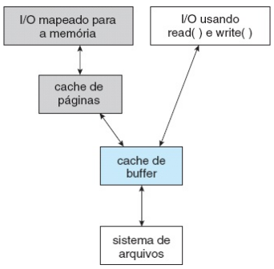
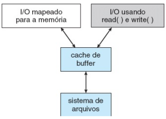

# -*- coding: utf-8 -*-
# -*- mode: org -*-
#+startup: beamer overview indent
#+LANGUAGE: pt-br
#+TAGS: noexport(n)
#+EXPORT_EXCLUDE_TAGS: noexport
#+EXPORT_SELECT_TAGS: export

#+Title: Sistemas Operacionais
#+Subtitle: Desempenho e Confiabilidade de Sistemas de Arquivos
#+Author: Prof. Lucas Mello Schnorr (UFRGS)
#+Date: \copyleft

#+LaTeX_CLASS: beamer
#+LaTeX_CLASS_OPTIONS: [xcolor=dvipsnames,10pt]
#+OPTIONS: H:1 num:t toc:nil \n:nil @:t ::t |:t ^:t -:t f:t *:t <:t
#+LATEX_HEADER: \input{org-babel.tex}

* Estrutura da aula

- Desempenho
  - Tamanho do bloco: desempenho \times espaço
  - Eficiência e desempenho do sistema de arquivos
  - Cache de buffer e cache de páginas
- Confiabilidade
  - Verificação de consistência (fsck)
  - Sistemas de arquivos estruturados em log (LFS)
  - Journaling: motivação, operação e recuperação
  - Backups

* -- Tamanho do Bloco: Desempenho \times Espaço

Todo arquivo ocupa um número inteiro de blocos

- Bloco grande: último bloco de cada arquivo desperdiça mais espaço
  - Arquivos de 4 KB em blocos de 16 KB: eficiência de 25%
- Bloco pequeno: arquivo espalhado em muitos blocos
  - Mais buscas e latência rotacional por arquivo lido

#+latex: \vfill

Desempenho e utilização do espaço estão em conflito (Tanenbaum)

- Maioria dos arquivos é pequena (poucos KB)
- Historicamente: blocos de 1 KB a 4 KB
- Discos de vários TB: espaço deixa de ser escasso
  - Blocos maiores (ex: 64 KB) passam a ser aceitáveis

* Eficiência e Desempenho do Sistema de Arquivos
** Fatores que afetam a eficiência

- Tamanho dos ponteiros (32 ou 64 bits) limita tamanho máximo
- Data de último acesso: leitura exige gravação no diretório
- Pré-alocação de i-nodes melhora localidade no disco

#+latex: \vfill\pause

** Melhorias de desempenho

- Cache no controlador: trilha inteira lida de uma vez
- Escrita assíncrona: dados no cache; disco atualizado depois
- Escrita síncrona: necessária para transações atômicas (BD)

#+latex: \vfill

** Otimizações para acesso sequencial

- read-ahead: ler página solicitada e páginas seguintes
- free-behind: liberar página anterior ao avançar na leitura

* Cache de Buffer e Cache de Páginas
** Cache de buffer (em RAM não usada por processos)
- Mantém blocos de disco supondo reutilização iminente
- Gerenciado pelo SF; acesso por endereço físico de bloco
** Cache de páginas (em RAM não usada por processos)
- Armazena dados de arquivos como páginas (memória virtual)
- Acesso por endereço virtual — mais eficiente que por bloco
- Linux, Solaris, Windows: cache de páginas unificado
** Left                                                              :BMCOL:
:PROPERTIES:
:BEAMER_col: 0.35
:END:

#+attr_latex: :width .95\linewidth

** Right                                                             :BMCOL:
:PROPERTIES:
:BEAMER_col: 0.60
:END:

Cache duplo (de buffer e de páginas)
- read()/write() passam pelo cache de buffer
- mmap() usa o os dois caches
Comportamento ruim
- Dados do FS são replicados
- Inconsistências entre os dois caches

* Integração com cache unificado

Cache unificado (somente de páginas)
- read()/write()
- mmap()

#+attr_latex: :width .55\linewidth

#+latex: \vfill

- Cache de páginas é a memória virtual (aulas 18 e 19)
  - Páginas de arquivos competem com páginas de processos
  - Substituição: aproximações do LRU, como nos quadros

* -- Verificação de Consistência e Recuperação

** Queda do sistema pode deixar estruturas do SF inconsistentes

- Diretórios, ponteiros de blocos podem ser corrompidos
- FCB (File Control Block / i-node): metadados do arquivo
  - Proprietário, permissões, localização dos blocos de dados
- Cache de gravação não descarregado antes da queda do sistema

#+latex: \vfill\pause

** Verificador de consistência (fsck / sfc)

- Constrói dois contadores por bloco (em arquivo / na lista livre)
- Bloco desaparecido: não está em arquivo nem na lista livre
  → adicionar à lista de blocos livres
- Bloco duplicado na lista livre → reconstruir lista
- Bloco em dois arquivos → copiar e corrigir referências

#+latex: \vfill

** Verificação de diretórios

- Contagens de ligações nos i-nodes devem bater com entradas
- Contagem alta demais: desperdiça espaço (não crítico)
- Contagem baixa demais: i-node removido prematuramente

* Sistemas de Arquivos Estruturados em Log (LFS)

Motivação (Berkeley, Rosenblum e Ousterhout, 1991)

- Caches maiores: maioria das leituras atendida na memória
- Disco passa a receber principalmente escritas pequenas
  - Criar arquivo: grava i-node do diretório, bloco do diretório,
    i-node do arquivo e dados, em lugares diferentes do disco
  - Escrita de 50 \mu{}s precedida de busca (10 ms) e rotação (4 ms)

#+latex: \vfill

Ideia: tratar o disco inteiro como um único log (diário)

- Escritas pendentes reunidas em segmentos de \approx 1 MB
- Segmento gravado de forma contígua no fim do log
- I-nodes espalhados pelo log: mapa de i-nodes para localizá-los
- Thread limpador compacta segmentos antigos (buffer circular)
- Escritas pequenas: uma ordem de grandeza mais rápidas que no UNIX

#+latex: \vfill

- Pouco usado na forma pura; a ideia do log inspirou o journaling

* Journaling: Motivação e Conceito

Operação simples (remover arquivo) envolve múltiplos passos:

1. Remover a entrada do diretório
2. Liberar o i-node para o conjunto de i-nodes livres
3. Devolver os blocos de dados para a lista de blocos livres

#+latex: \vfill\pause

** Queda do sistema no meio da operação gera inconsistência

- I-node e blocos ficam inacessíveis e não realocáveis
- Verificador (fsck/sfc) pode levar minutos ou horas
- Sistemas de terabytes: horas de verificação na inicialização

#+latex: \vfill\pause

** Solução: sistemas de arquivos journaling

- Registrar operações no diário antes de executá-las
- Ao reiniciar: retomar ou desfazer operações pendentes
- Exemplos: NTFS, ext3, ext4, ReiserFS, HFS+

* Journaling: Operação e Recuperação

Funcionamento do diário (/write-ahead log/):

1. Gravar entrada no diário com as ações a executar
2. Confirmar a gravação no diário (flush para disco)
3. Executar as operações nas estruturas reais do SF
4. Remover a transação do diário ao concluir

#+latex: \vfill\pause

** Recuperação após queda

- Transações confirmadas mas incompletas: reexecutar
- Transações não confirmadas: descartar (rollback)
- Operações devem ser idempotentes — podem ser repetidas

#+latex: \vfill\pause

** Benefício adicional: desempenho

- Escritas síncronas randômicas → escritas sequenciais no log
- Log: buffer circular em seção separada do sistema de arquivos

* Backups

Protegem contra o que o journaling não resolve

- Falhas de disco, desastres, exclusão acidental, ataques
- Restauração: copiar os dados de volta a partir da cópia de segurança

#+latex: \vfill

Estratégias

- Backup completo: copia todo o sistema de arquivos
- Backup incremental: copia só o que mudou desde o último backup
  - Restaurar exige o último completo + todos os incrementais
- Dump físico: copia blocos do disco, do primeiro ao último
- Dump lógico: percorre a árvore e copia arquivos e diretórios
  - Permite restaurar um arquivo ou diretório isolado

* Referências

- Silberschatz
  - Cap. 12, Sec. 12.6 (Eficiência e Desempenho)
  - Cap. 12, Sec. 12.7 (Recuperação: consistência, LFS, backup)
- Tanenbaum
  - Cap. 4, Sec. 4.3.5 (Sistemas de arquivos estruturados em log)
  - Cap. 4, Sec. 4.3.6 (Sistemas de arquivos journaling)
  - Cap. 4, Sec. 4.4.1 (Tamanho do bloco)
  - Cap. 4, Secs. 4.4.2–4.4.4 (Backups, consistência e desempenho)
