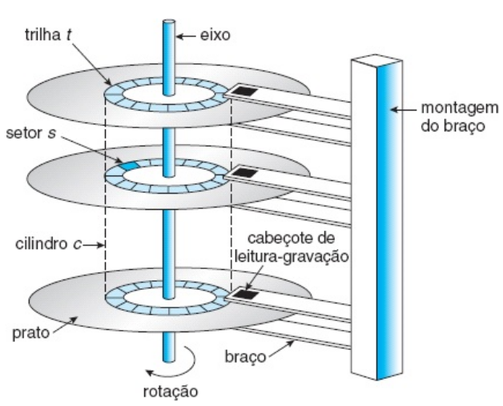
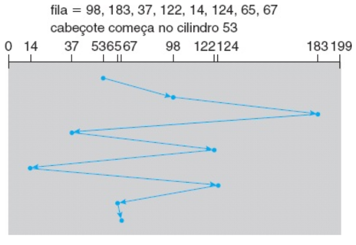
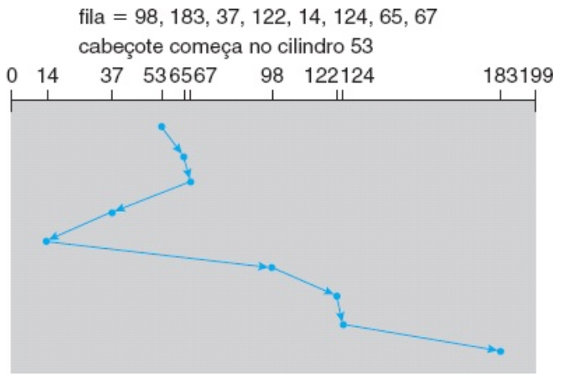
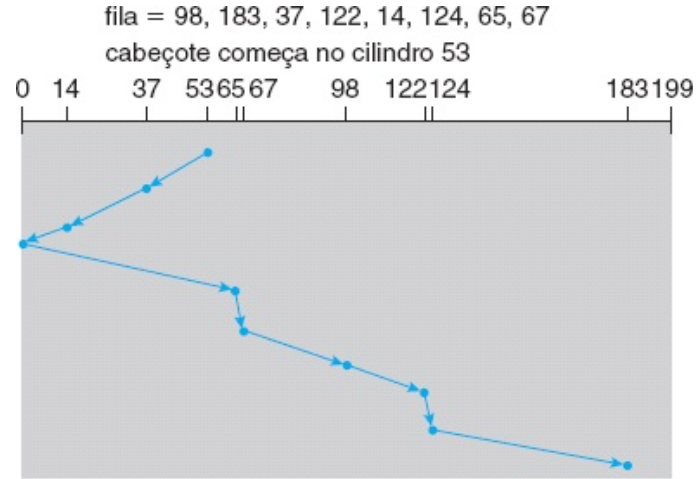
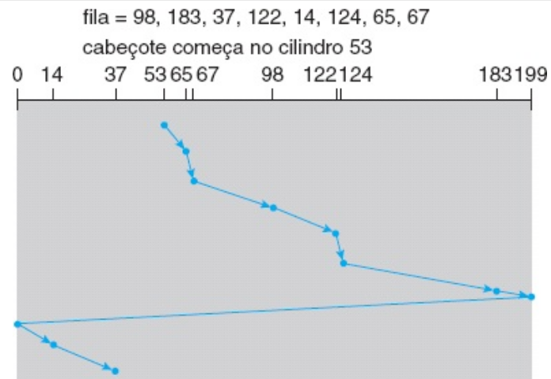
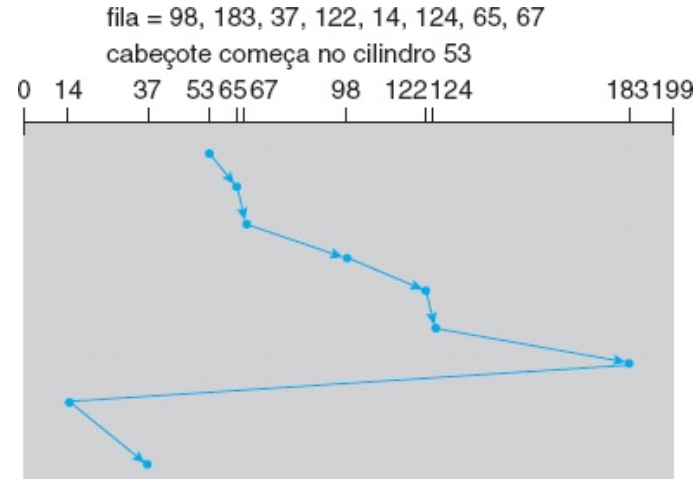

# -*- coding: utf-8 -*-
# -*- mode: org -*-
#+startup: beamer overview indent
#+LANGUAGE: pt-br
#+TAGS: noexport(n)
#+EXPORT_EXCLUDE_TAGS: noexport
#+EXPORT_SELECT_TAGS: export

#+Title: Sistemas Operacionais
#+Subtitle: Discos: Estrutura, Escalonamento e SSD
#+Author: Prof. Lucas Mello Schnorr (UFRGS)
#+Date: \copyleft

#+LaTeX_CLASS: beamer
#+LaTeX_CLASS_OPTIONS: [xcolor=dvipsnames,10pt]
#+OPTIONS: H:1 num:t toc:nil \n:nil @:t ::t |:t ^:t -:t f:t *:t <:t
#+LATEX_HEADER: \input{org-babel.tex}

* Estrutura da aula

- Disco magnético: o que limita o desempenho
  - Estrutura física: prato, trilha, setor, cilindro
  - Desempenho: busca, latência rotacional, transferência
- Escalonamento de disco
  - FCFS, SSTF, SCAN, C-SCAN, LOOK e C-LOOK
  - Seleção do algoritmo
- Discos de estado sólido (SSD)

* -- Disco Magnético: Estrutura Física 1/2

Disco magnético fornece grande parte do armazenamento secundário

- Prato: superfície circular coberta por material magnético
  - Dados armazenados magneticamente na superfície do prato
- Superfície dividida em trilhas circulares concêntricas
  - Trilhas subdivididas em setores (unidade mínima de transferência)
- Cilindro: conjunto de trilhas na mesma posição do braço
  - Discos modernos têm dezenas de milhares de cilindros

#+attr_latex: :width .5\linewidth

#+latex: \vfill

* Disco Magnético: Estrutura Física 2/2

- Cabeça de leitura/escrita flutua sobre a superfície do prato
  - Cabeças fixadas ao braço do disco; movem-se todas juntas
- Disco rígido: múltiplos pratos empilhados, uma cabeça por superfície
- Velocidade medida em RPM: 5.400, 7.200, 10.000, 15.000 RPM

#+attr_latex: :width .7\linewidth

* Desempenho do Disco

Tempo de acesso randômico composto por três parcelas:

- Tempo de busca: mover o braço até o cilindro desejado
  - Componente dominante — varia de 3 a 15 ms em discos modernos
- Latência rotacional: esperar o setor girar até a cabeça
  - Em 7.200 RPM: rotação completa em 8,3 ms; latência média \approx 4,2 ms

#+latex: \vfill

- Tempo de transferência: taxa em que dados fluem entre disco e memória
  - Discos modernos transferem centenas de MB/s
- Largura de banda: total de bytes transferidos / tempo total do acesso

#+latex: \vfill

- Para a maioria dos discos, tempo de busca domina os demais
  - Reduzir a distância média de busca melhora o desempenho

* -- Escalonamento de Disco: Motivação

Em sistema multiprogramado, vários processos emitem requisições ao disco

- Fila de requisições: cilindros 98, 183, 37, 122, 14, 124, 65, 67
  - Cabeça inicialmente no cilindro 53
- O SO pode reordenar a fila para reduzir o movimento da cabeça

#+latex: \vfill

- Objetivo: minimizar o movimento total da cabeça (tempo de busca)
- Cada requisição especifica: direção (leitura/escrita), endereço de
  disco, endereço de memória, número de setores a transferir

#+latex: \vfill

- Algoritmos de escalonamento diferem na ordem de atendimento
  - Impacto direto no desempenho e na equidade entre processos

* Escalonamento FCFS

FCFS: primeiro a chegar, primeiro a ser atendido

- Algoritmo intrinsecamente justo; simples de implementar
- Ordem de atendimento: 98, 183, 37, 122, 14, 124, 65, 67
  - Partindo do cilindro 53 → movimento total de 640 cilindros

#+attr_latex: :width .5\linewidth

#+latex: \vfill

- Problema: mudanças bruscas de direção degradam o desempenho
  - Cilindro 122 → 14 → 124: retrocede e avança desnecessariamente
- Com fila longa, o FCFS ignora a proximidade entre requisições
  - Requisições próximas à cabeça não têm prioridade

#+latex: \vfill

- FCFS é adequado quando a fila tem geralmente apenas uma requisição
  - Com fila vazia, todos os algoritmos se comportam como FCFS

* Escalonamento SSTF

SSTF: menor tempo de busca primeiro (Shortest Seek Time First)

- Seleciona a requisição pendente mais próxima da posição atual
- Exemplo: de 53 → 65, 67, 37, 14, 98, 122, 124, 183
  - Movimento total: 236 cilindros (\approx 1/3 do FCFS)

#+attr_latex: :width .5\linewidth

#+latex: \vfill

- Análogo ao escalonamento SJF de processos

#+latex: \vfill

- Problema: pode causar inanição de requisições distantes
  - Fluxo contínuo de requisições próximas pode bloquear cilindros
    distantes indefinidamente
- SSTF não é ótimo: há ordenações com desempenho ainda melhor
  - Exemplo: 53 → 37, 14, 65, 67, 98, 122, 124, 183 = 208 cilindros

* Escalonamento SCAN

SCAN: braço varre o disco de uma extremidade à outra

- Atende requisições conforme alcança cada cilindro
- Ao chegar à extremidade, inverte a direção e repete a varredura

#+latex: \vfill

- Exemplo (movendo em direção ao cilindro 0, partindo de 53):
  - Atende 37, 14 → chega ao cilindro 0 → inverte
  - Atende 65, 67, 98, 122, 124, 183

#+attr_latex: :width .5\linewidth

#+latex: \vfill

- Vantagem: sem inanição; todas as requisições são atendidas
- Problema: requisição que acaba de passar pela cabeça espera
  um ciclo completo até ser atendida novamente
- Carga não uniforme: cilindros centrais são mais atendidos

* Escalonamento C-SCAN (Circular SCAN)

- Variante do SCAN com tempo de espera mais uniforme
- Move a cabeça de uma extremidade à outra atendendo requisições
- Ao atingir o fim, retorna imediatamente ao início sem atender
  - Trata os cilindros como uma lista circular
  
#+latex: \vfill

- Garante tempo de espera mais uniforme do que o SCAN
  - Evita o favorecimento dos cilindros do meio

#+latex: \vfill

- Exemplo (partindo de 53, movendo em direção ao cilindro 199):
  - Atende 65, 67, 98, 122, 124, 183, 199 → retorna ao 0
  - Atende 14, 37 na próxima passagem

#+attr_latex: :width .5\linewidth

* Algoritmos LOOK e C-LOOK, variantes do SCAN, C-SCAN

LOOK: variante do SCAN

- Braço vai apenas até o local da última requisição em cada direção
  - Inverte imediatamente, sem alcançar a extremidade do disco
- Evita movimento desnecessário além da última requisição

#+latex: \vfill

C-LOOK: variante do C-SCAN sem percorrer todo o disco

- Ao atender a última requisição em uma direção, retorna à
  primeira requisição pendente no sentido oposto
- Não percorre os cilindros entre a última requisição e a borda

#+attr_latex: :width .5\linewidth

#+latex: \vfill

- LOOK e C-LOOK são as implementações práticas mais comuns
  - SCAN e C-SCAN raramente implementados em sua forma pura
# - O algoritmo do elevador em prédios usa lógica equivalente ao LOOK

* Seleção do Algoritmo de Escalonamento

Nenhum algoritmo é ótimo em todas as situações

- FCFS: justo, simples, mas ineficiente com filas longas
- SSTF: melhora o desempenho médio, porém pode causar inanição
- SCAN/LOOK: sem inanição; melhor sob carga pesada
- C-SCAN/C-LOOK: tempo de espera mais uniforme que SCAN

#+latex: \vfill

- Desempenho depende do número e tipo de requisições
  - Fila com uma requisição: todos os algoritmos equivalem ao FCFS
- Método de alocação de arquivos (aula 23) influencia as requisições
  - Arquivo contíguo: requisições próximas → pouco movimento
  - Arquivo encadeado ou indexado: requisições espalhadas → mais movimento

#+latex: \vfill

- Algoritmo deve ser módulo separado do SO — substituível
  - SSTF e LOOK são opções aceitáveis como algoritmo padrão

* -- Discos de Estado Sólido (SSD)

SSD: memória não volátil usada como unidade de armazenamento

- Sem partes mecânicas em movimento
  - Sem braço, sem pratos giratórios, sem cabeça de leitura/escrita
- Tecnologias: memória flash SLC (célula de um nível) e MLC

#+latex: \vfill

- Vantagens em relação ao disco magnético:
  - Sem tempo de busca e sem latência rotacional
  - Maior velocidade de acesso (leituras especialmente rápidas)
  - Menor consumo de energia; maior robustez a impactos

#+latex: \vfill

- Desvantagens:
  - Custo mais elevado por gigabyte
  - Capacidade máxima menor do que grandes discos magnéticos
  - Vida útil limitada pelo número de ciclos de escrita por célula
- Escalonamento de disco quase não se aplica a SSDs
  - Sem braço: a ordem das requisições pouco importa

* SSD por Dentro e na Prática

Controlador do SSD esconde as limitações da memória flash

- Flash não sobrescreve no lugar: apaga blocos inteiros antes
- FTL (/Flash Translation Layer/): mapeia blocos lógicos em físicos
  - Escrita vai para página já apagada; a antiga fica inválida
  - Coleta de lixo recupera blocos com páginas inválidas
- Nivelamento de desgaste (/wear leveling/): espalha as escritas
- TRIM: SO avisa quais blocos o sistema de arquivos liberou

#+latex: \vfill

Escalonador de E/S no Linux (por dispositivo)

#+BEGIN_SRC text
$ cat /sys/block/nvme0n1/queue/scheduler
[none] mq-deadline
#+END_SRC

- SSD NVMe: =none= (sem reordenação), como o FCFS
- Disco magnético: =mq-deadline= ou =bfq= (reordenam por posição)

* Referências

- Silberschatz
  - Cap. 10, Secs. 10.1, 10.2 (Estrutura e desempenho do disco)
  - Cap. 10, Sec. 10.4 (Escalonamento de disco)
- Tanenbaum
  - Cap. 5, Sec. 5.4.1 (Hardware do disco)
  - Cap. 5, Sec. 5.4.3 (Algoritmos de escalonamento do braço do disco)
