# -*- coding: utf-8 -*-
# -*- mode: org -*-
#+startup: beamer overview indent
#+LANGUAGE: pt-br
#+TAGS: noexport(n)
#+EXPORT_EXCLUDE_TAGS: noexport
#+EXPORT_SELECT_TAGS: export

#+Title: Sistemas Operacionais
#+Subtitle: Discos e RAID
#+Author: Prof. Lucas Mello Schnorr (UFRGS)
#+Date: \copyleft

#+LaTeX_CLASS: beamer
#+LaTeX_CLASS_OPTIONS: [xcolor=dvipsnames,10pt]
#+OPTIONS: H:1 num:t toc:nil \n:nil @:t ::t |:t ^:t -:t f:t *:t <:t
#+LATEX_HEADER: \input{org-babel.tex}

* Estrutura da aula

- Disco magnético
  - Estrutura física: prato, trilha, setor, cilindro
  - Desempenho: busca, latência rotacional, transferência
- Escalonamento de disco
  - FCFS, SSTF, SCAN, C-SCAN, LOOK e C-LOOK
  - Seleção do algoritmo
- Discos de estado sólido (SSD)
- RAID
  - Motivação, conceito e níveis 0 a 6
  - Níveis combinados 0+1 e 1+0
- Síntese: o caminho de uma requisição de E/S

* Disco Magnético: Estrutura Física 1/2

Disco magnético fornece grande parte do armazenamento secundário

- Prato: superfície circular coberta por material magnético
  - Dados armazenados magneticamente na superfície do prato
- Superfície dividida em trilhas circulares concêntricas
  - Trilhas subdivididas em setores (unidade mínima de transferência)
- Cilindro: conjunto de trilhas na mesma posição do braço
  - Discos modernos têm dezenas de milhares de cilindros

#+attr_latex: :width .5\linewidth
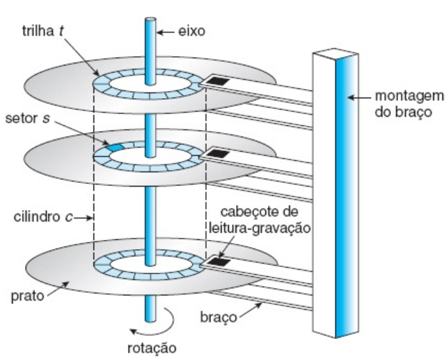

#+latex: \vfill

* Disco Magnético: Estrutura Física 2/2

- Cabeça de leitura/escrita flutua sobre a superfície do prato
  - Cabeças fixadas ao braço do disco; movem-se todas juntas
- Disco rígido: múltiplos pratos empilhados, uma cabeça por superfície
- Velocidade medida em RPM: 5.400, 7.200, 10.000, 15.000 RPM

#+attr_latex: :width .7\linewidth

* Desempenho do Disco

Tempo de acesso randômico composto por três parcelas:

- Tempo de busca: mover o braço até o cilindro desejado
  - Componente dominante — varia de 3 a 15 ms em discos modernos
- Latência rotacional: esperar o setor girar até a cabeça
  - Em 7.200 RPM: rotação completa em 8,3 ms; latência média \approx 4,2 ms

#+latex: \vfill

- Tempo de transferência: taxa em que dados fluem entre disco e memória
  - Discos modernos transferem centenas de MB/s
- Largura de banda: total de bytes transferidos / tempo total do acesso

#+latex: \vfill

- Para a maioria dos discos, tempo de busca domina os demais
  - Reduzir a distância média de busca melhora o desempenho

* -- Escalonamento de Disco: Motivação

Em sistema multiprogramado, vários processos emitem requisições ao disco

- Fila de requisições: cilindros 98, 183, 37, 122, 14, 124, 65, 67
  - Cabeça inicialmente no cilindro 53
- O escalonador de E/S (aula 26) escolhe a próxima requisição

#+latex: \vfill

- Objetivo: minimizar o movimento total da cabeça (tempo de busca)
- Cada requisição especifica: direção (leitura/escrita), endereço de
  disco, endereço de memória, número de setores a transferir

#+latex: \vfill

- Algoritmos de escalonamento diferem na ordem de atendimento
  - Impacto direto no desempenho e na equidade entre processos

* Escalonamento FCFS

FCFS: primeiro a chegar, primeiro a ser atendido

- Algoritmo intrinsecamente justo; simples de implementar
- Ordem de atendimento: 98, 183, 37, 122, 14, 124, 65, 67
  - Partindo do cilindro 53 → movimento total de 640 cilindros

#+attr_latex: :width .5\linewidth
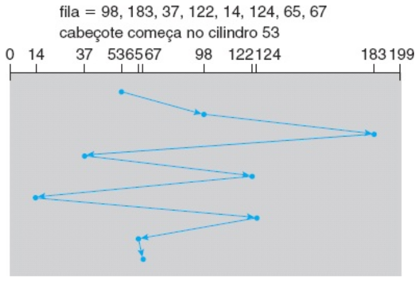

#+latex: \vfill

- Problema: mudanças bruscas de direção degradam o desempenho
  - Cilindro 122 → 14 → 124: retrocede e avança desnecessariamente
- Com fila longa, o FCFS ignora a proximidade entre requisições
  - Requisições próximas à cabeça não têm prioridade

#+latex: \vfill

- FCFS é adequado quando a fila tem geralmente apenas uma requisição
  - Com fila vazia, todos os algoritmos se comportam como FCFS

* Escalonamento SSTF

SSTF: menor tempo de busca primeiro (Shortest Seek Time First)

- Seleciona a requisição pendente mais próxima da posição atual
- Exemplo: de 53 → 65, 67, 37, 14, 98, 122, 124, 183
  - Movimento total: 236 cilindros (\approx 1/3 do FCFS)

#+attr_latex: :width .5\linewidth
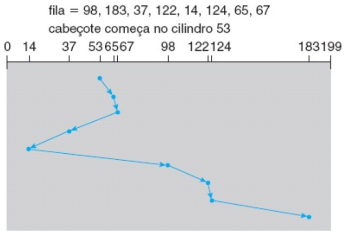

#+latex: \vfill

- Análogo ao escalonamento SJF de processos

#+latex: \vfill

- Problema: pode causar inanição de requisições distantes
  - Fluxo contínuo de requisições próximas pode bloquear cilindros
    distantes indefinidamente
- SSTF não é ótimo: há ordenações com desempenho ainda melhor
  - Exemplo: 53 → 37, 14, 65, 67, 98, 122, 124, 183 = 208 cilindros

* Escalonamento SCAN

SCAN: braço varre o disco de uma extremidade à outra

- Atende requisições conforme alcança cada cilindro
- Ao chegar à extremidade, inverte a direção e repete a varredura

#+latex: \vfill

- Exemplo (movendo em direção ao cilindro 0, partindo de 53):
  - Atende 37, 14 → chega ao cilindro 0 → inverte
  - Atende 65, 67, 98, 122, 124, 183

#+attr_latex: :width .5\linewidth
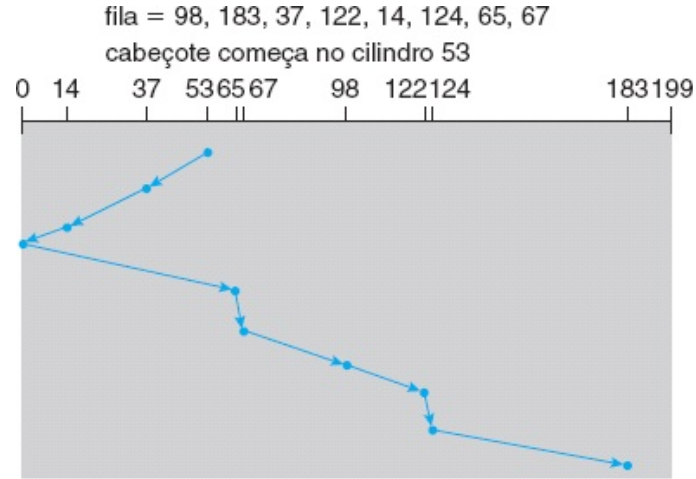

#+latex: \vfill

- Vantagem: sem inanição; todas as requisições são atendidas
- Problema: requisição que acaba de passar pela cabeça espera
  um ciclo completo até ser atendida novamente
- Carga não uniforme: cilindros centrais são mais atendidos

* Escalonamento C-SCAN (Circular SCAN)

- Variante do SCAN com tempo de espera mais uniforme
- Move a cabeça de uma extremidade à outra atendendo requisições
- Ao atingir o fim, retorna imediatamente ao início sem atender
  - Trata os cilindros como uma lista circular
  
#+latex: \vfill

- Garante tempo de espera mais uniforme do que o SCAN
  - Evita o favorecimento dos cilindros do meio

#+latex: \vfill

- Exemplo (partindo de 53, movendo em direção ao cilindro 199):
  - Atende 65, 67, 98, 122, 124, 183, 199 → retorna ao 0
  - Atende 14, 37 na próxima passagem

#+attr_latex: :width .5\linewidth
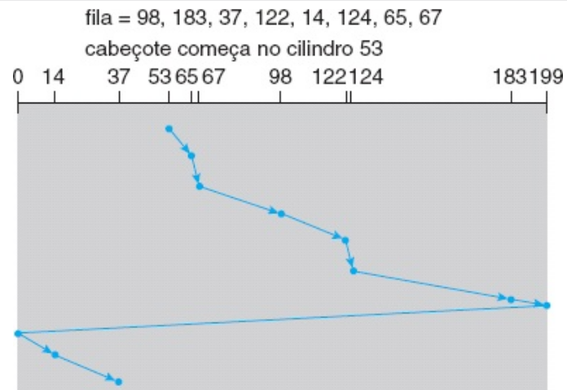

* Algoritmos LOOK e C-LOOK, variantes do SCAN, C-SCAN

LOOK: variante do SCAN

- Braço vai apenas até o local da última requisição em cada direção
  - Inverte imediatamente, sem alcançar a extremidade do disco
- Evita movimento desnecessário além da última requisição

#+latex: \vfill

C-LOOK: variante do C-SCAN sem percorrer todo o disco

- Ao atender a última requisição em uma direção, retorna à
  primeira requisição pendente no sentido oposto
- Não percorre os cilindros entre a última requisição e a borda

#+attr_latex: :width .5\linewidth
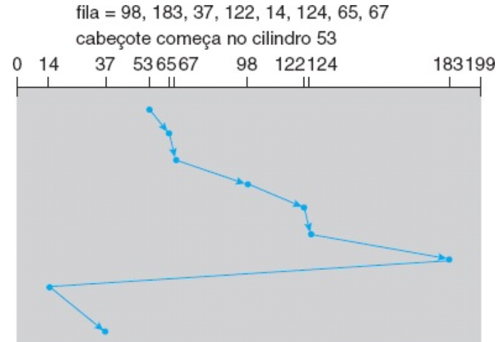

#+latex: \vfill

- LOOK e C-LOOK são as implementações práticas mais comuns
  - SCAN e C-SCAN raramente implementados em sua forma pura
# - O algoritmo do elevador em prédios usa lógica equivalente ao LOOK

* Seleção do Algoritmo de Escalonamento

Nenhum algoritmo é ótimo em todas as situações

- FCFS: justo, simples, mas ineficiente com filas longas
- SSTF: melhora o desempenho médio, porém pode causar inanição
- SCAN/LOOK: sem inanição; melhor sob carga pesada
- C-SCAN/C-LOOK: tempo de espera mais uniforme que SCAN

#+latex: \vfill

- Desempenho depende do número e tipo de requisições
  - Fila com uma requisição: todos os algoritmos equivalem ao FCFS
- Método de alocação de arquivos (aula 23) influencia as requisições
  - Arquivo contíguo: requisições próximas → pouco movimento
  - Arquivo encadeado ou indexado: requisições espalhadas → mais movimento

#+latex: \vfill

- Algoritmo deve ser módulo separado do SO — substituível
  - SSTF e LOOK são opções aceitáveis como algoritmo padrão

* -- Discos de Estado Sólido (SSD)

SSD: memória não volátil usada como unidade de armazenamento

- Sem partes mecânicas em movimento
  - Sem braço, sem pratos giratórios, sem cabeça de leitura/escrita
- Tecnologias: memória flash SLC (célula de um nível) e MLC

#+latex: \vfill

- Vantagens em relação ao disco magnético:
  - Sem tempo de busca e sem latência rotacional
  - Maior velocidade de acesso (leituras especialmente rápidas)
  - Menor consumo de energia; maior robustez a impactos

#+latex: \vfill

- Desvantagens:
  - Custo mais elevado por gigabyte
  - Capacidade máxima menor do que grandes discos magnéticos
  - Vida útil limitada pelo número de ciclos de escrita por célula
- Escalonamento de disco quase não se aplica a SSDs
  - Sem braço: a ordem das requisições pouco importa

* SSD por Dentro e na Prática

Controlador do SSD esconde as limitações da memória flash

- Flash não sobrescreve no lugar: apaga blocos inteiros antes
- FTL (/Flash Translation Layer/): mapeia blocos lógicos em físicos
  - Escrita vai para página já apagada; a antiga fica inválida
  - Coleta de lixo recupera blocos com páginas inválidas
- Nivelamento de desgaste (/wear leveling/): espalha as escritas
- TRIM: SO avisa quais blocos o sistema de arquivos liberou

#+latex: \vfill

Escalonador de E/S no Linux (por dispositivo)

#+BEGIN_SRC text
$ cat /sys/block/nvme0n1/queue/scheduler
[none] mq-deadline
#+END_SRC

- SSD NVMe: =none= (sem reordenação), como o FCFS
- Disco magnético: =mq-deadline= ou =bfq= (reordenam por posição)

* -- RAID: Motivação

Discos são o componente mais lento do computador

- Falha de um disco causa perda de dados
- Risco cresce com o número de discos no sistema
  - MTTF: /Mean Time To Failure/ (tempo médio até a falha)
  - Array de 100 discos com MTTF de 100.000 h
    - Falha esperada a cada 1.000 h (\approx 41 dias)

#+latex: \vfill

Dois objetivos fundamentais para arrays de discos:

- Confiabilidade: recuperar dados após falha de um disco
  - Solução: redundância \to informação extra para reconstrução
    - Técnica de espelhamento
- Desempenho: aumentar a taxa de transferência de dados
  - Solução: paralelismo \to múltiplos discos em conjunto
    - Técnica de espalhamento (/striping/)

* RAID: Conceito e Definição

RAID — /Redundant Array of +Inexpensive+ Independent Disks/

- Contrapartida do SLED (/Single Large Expensive Disk/)
- Array deve parecer um disco único ao sistema operacional
- Técnicas: /striping/ (distribuir) ou espelhamento (duplicar)

#+latex: \vfill

** Sete configurações padrão: RAID nível 0 a RAID nível 6

- Cada nível é uma organização diferente, sem hierarquia

#+latex: \vfill\pause

** Implementações possíveis

- Software (no kernel ou em camada do sistema)
- Hardware no adaptador de barramento (HBA)
- Hardware no array de armazenamento dedicado

#+latex: \vfill\pause

** Recurso adicional: disco de segurança (/hot spare/)

- Disco reserva substituído automaticamente em caso de falha

* RAID 0 — Striping sem Redundância

Técnica: distribuição de dados (/striping/)

- Disco virtual dividido em faixas de k setores cada
- Faixas consecutivas distribuídas nos discos em round-robin
- Controlador divide acesso grande em comandos paralelos

#+attr_latex: :width .6\linewidth
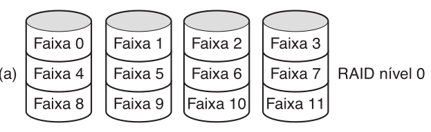

#+latex: \vfill\pause

** Desempenho

- N discos: taxa de transferência N \times maior
  para acessos de múltiplos blocos
- Sem ganho para acessos de um setor por vez

#+latex: \vfill\pause

** Limitação crítica

- Nenhuma redundância — não é RAID verdadeiro
- Falha de um disco destrói todos os dados do array
- MTBF do array é N vezes menor que o de um disco

* RAID 1 — Espelhamento

Técnica: duplicação completa de todos os discos

- Cada faixa gravada nos dois discos do par (espelhamento)
- Volume espelhado: disco lógico com dois discos físicos
- Sem distribuição — tudo é duplicado

#+attr_latex: :width .9\linewidth
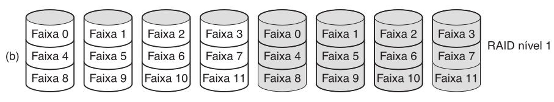

#+latex: \vfill

** Desempenho

- Leitura: qualquer cópia pode ser usada — dobra o throughput
- Escrita: sem melhora — ambos os discos recebem os dados

#+latex: \vfill

** Confiabilidade

- Falha de um disco: a cópia do par continua funcionando
- Recuperação: instalar novo disco e copiar dados do espelho
- Tempo médio até a perda de dados \approx 57.000 anos @@latex:\linebreak@@
  (MTTF=100.000 h, tempo de reparo=10 h)

* RAID 2 — Código de Hamming com Sincronização

Técnica: striping em nível de palavra/byte com código Hamming

- Cada palavra de dados dividida bit a bit entre os discos
- Bits de paridade Hamming em discos adicionais (não representados)
  - Correção de erro de 1 bit sem parar o sistema

#+attr_latex: :width .9\linewidth
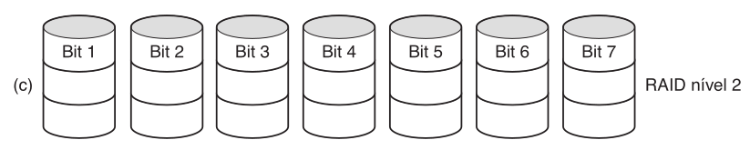

#+latex: \vfill

Requisitos e limitações:

- Discos rigorosamente sincronizados (rotação e braço)
- Sobrecarga: 19% com 32 discos de dados + 6 de paridade
- Controlador complexo: verificação Hamming em cada bit
- Uso: sistemas de alto desempenho (ex.: CM-2 da Thinking Machines)

#+latex: \vfill

Raramente utilizado na prática devido à complexidade

* RAID 3 — Paridade Simples com Sincronização

Técnica: versão simplificada do RAID 2

- Um único bit de paridade por palavra de dados
- Paridade gravada em disco dedicado
- Discos sincronizados: palavras espalhadas por múltiplos discos

#+attr_latex: :width .9\linewidth
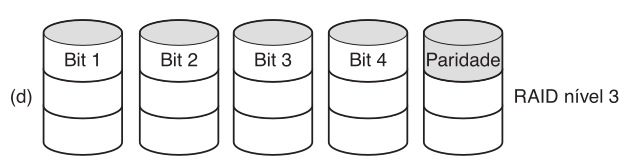

#+latex: \vfill\pause

** Correção de erro na falha de disco

- Posição do bit defeituoso é conhecida (disco quebrado)
- Controlador trata bits do disco falho como 0
- Erro de paridade indica que o bit deveria ser 1 — corrigido

#+latex: \vfill\pause

** Limitação: número de operações E/S por segundo não melhora
- Taxa de dados alta, mas não paraleliza requisições

* RAID 4 — Paridade em Disco Dedicado

#+begin_center
[Como o RAID 0 + paridade faixa por faixa em disco extra]

#+attr_latex: :width .3\linewidth

#+end_center

RAID 4 — paridade por blocos intercalados em disco dedicado

- N discos de dados + 1 disco de paridade (XOR das faixas)
- Leitura de um bloco: acessa apenas um disco de dados
- Pequenas escritas: ciclo leitura-modificação-gravação
  (4 acessos ao disco por escrita)
- Problema: disco de paridade único torna-se gargalo

#+attr_latex: :width .9\linewidth
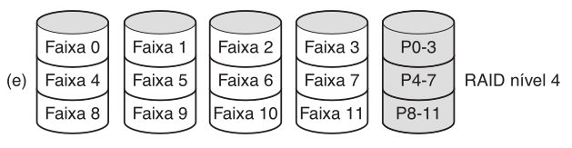

* RAID 5 — Paridade Distribuída

RAID 5 — paridade distribuída com blocos intercalados

- Dados e paridade distribuídos por todos os N+1 discos
- Paridade do bloco n: disco (n mod N) + 1
- Elimina o gargalo do disco de paridade único
- Nível RAID com paridade mais utilizado na prática

#+attr_latex: :width .9\linewidth
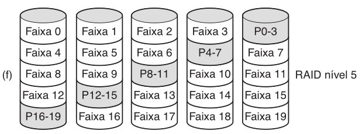

* RAID 6 — Redundância da Paridade Distribuída

RAID 6 — esquema de redundância P + Q (ou P + P' como na figura)

- Dois blocos de paridade (ex.: códigos Reed-Solomon)
- Tolera falha simultânea de até dois discos
- Escritas mais custosas; leituras sem penalidade adicional

#+attr_latex: :width .9\linewidth
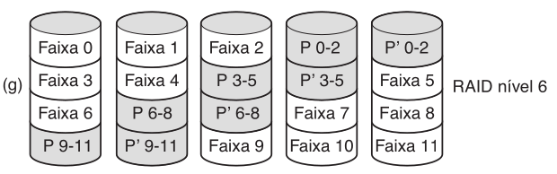

* Comparação dos Níveis
** Níveis e características                                        :BMCOL:

| Nível  | Redundância    | Overhead |
|--------+----------------+----------|
| RAID 0 | nenhuma        | 0%       |
| RAID 1 | espelhamento   | 100%     |
| RAID 4 | paridade única | 1/N      |
| RAID 5 | paridade dist. | 1/N      |
| RAID 6 | 2 paridades    | 2/N      |

** Uso típico

- RAID 0: alto desempenho, dados não críticos
- RAID 1: alta disponibilidade, recuperação rápida
- RAID 5: volumes grande, custo/desempenho equilibrado
- RAID 6: máxima confiabilidade

#+latex: \vfill

** Outro uso: desempenho e confiabilidade igualmente importantes
- Exemplo: bancos de dados pequenos

* RAID 0+1 e 1+0 — Níveis Combinados

RAID 0+1 — striping depois espelhamento

- Primeiro: criar distribuição (striping) dos dados
- Depois: espelhar toda a distribuição
- Falha de um disco: distribuição inteira fica inacessível

#+attr_latex: :width .27\linewidth
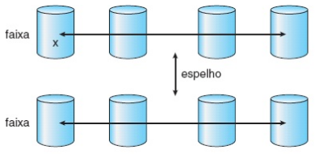

#+latex: \vfill

RAID 1+0 (/RAID 10/) — espelhamento depois striping

- Primeiro: espelhar discos em pares
- Depois: distribuir os pares espelhados
- Falha de um disco: apenas ele fica indisponível
- Disco espelhado continua disponível

#+attr_latex: :width .27\linewidth
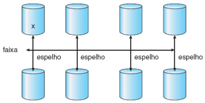

#+begin_center
Melhor desempenho que RAID 5, mas overhead de 100%
#+end_center

* -- Síntese: o Caminho de uma Requisição de E/S

** Left                                                              :BMCOL:
:PROPERTIES:
:BEAMER_col: 0.55
:END:

=read()= bloqueante de um arquivo em disco

#+latex: {\small
1. Kernel verifica parâmetros; dado no cache? retorna (aula 25)
2. Senão: SF traduz nome → i-node → bloco (aulas 22–24)
3. Processo bloqueia; requisição vai para a fila do dispositivo
4. Escalonador de E/S ordena a fila (aulas 26 e 27)
5. Driver programa o controlador e o DMA (aula 26)
6. Controlador transfere os dados; DMA gera interrupção
7. Tratador sinaliza o driver; kernel copia os dados
8. Processo volta à fila de prontos; =read()= retorna
#+latex: }

** Right                                                             :BMCOL:
:PROPERTIES:
:BEAMER_col: 0.45
:END:

#+attr_latex: :width \linewidth
[[./img/S_fig13.13.png]]

* Referências

- Silberschatz
  - Cap. 10, Secs. 10.1, 10.2, 10.4 (Disco e escalonamento)
  - Cap. 10, Sec. 10.7 (RAID)
  - Cap. 13, Sec. 13.5 (Requisições de E/S em operações de hardware)
- Tanenbaum
  - Cap. 5, Sec. 5.4.1 (Hardware do disco e RAID)
  - Cap. 5, Sec. 5.4.3 (Algoritmos de escalonamento do braço do disco)
